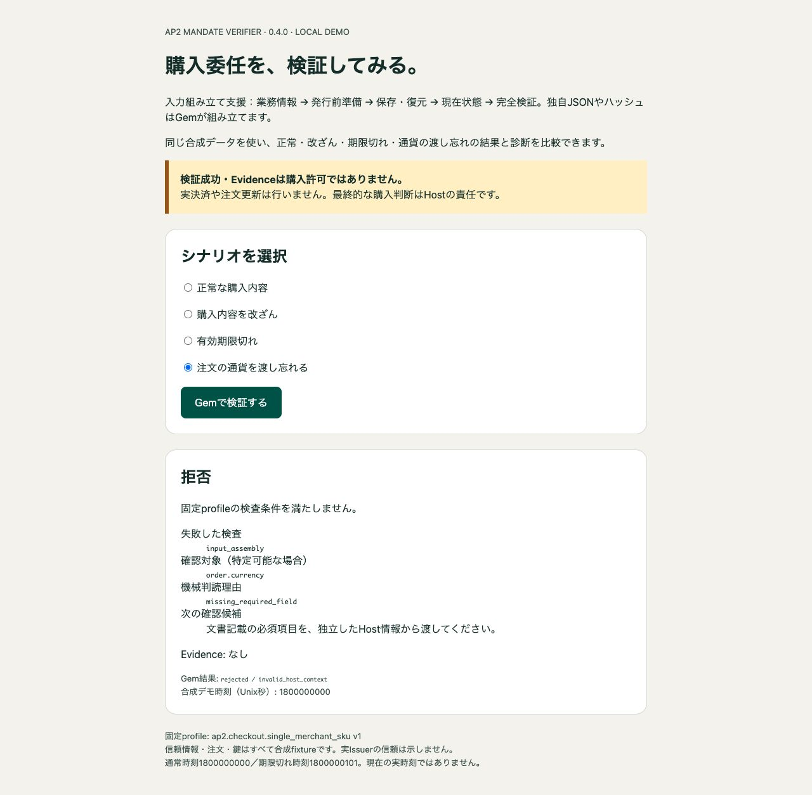

# AP2 Mandate Verifier Demo

Ruby／Rails開発者向けのローカル専用Railsアプリです。公開済み [ap2_mandate_verifier 0.4.0](https://rubygems.org/gems/ap2_mandate_verifier/versions/0.4.0) のInputBuilderと診断を通常起動で使い、正常・拒否・次の確認候補を実Gemで比較できます。

業務情報 → Challenge発行前準備 → 保存・復元 → 独立した現在状態 → 完全検証を示します。独立した合成注文・登録公開鍵・署名原文を使い、署名claimから信頼や期待金額を自己承認しません。

**検証成功・Evidenceは購入許可ではありません。** 実決済、注文更新、実Issuer連携、nonceの実発行・消費や注文CASは行いません。最終業務判断と原子的消費はHostの責任です。



## 4つのシナリオ

| 選択 | 実際のGem結果 | 診断の確認候補 | Evidence |
| --- | --- | --- | --- |
| 正常な購入内容 | verified_research / scoped_research_verified | 成功時は失敗診断なし | あり（検証事実のみ） |
| 購入内容を改ざん | rejected / host_binding_mismatch | 保存済みchallengeと現在の注文・trust・原文を照合 | なし |
| 有効期限切れ | rejected / invalid_purchase_time | 独立した時計と署名済み有効期間を確認 | なし |
| 注文の通貨を渡し忘れる | rejected / invalid_host_context | input_assembly / order.currency / missing_required_field | なし |

診断のstage・field・reason・日本語hintは補助情報であり、判定や既存status/codeを変えません。原因を断定せず、特定不能な項目は「特定できません」と表示します。実装では `result.diagnostic&.to_h(locale: :ja)` を使います（英語は `:en`）。[日本語診断ガイド](https://github.com/cuichangquan/ap2-mandate-verifier/blob/main/docs/DIAGNOSTICS.ja.md)。

通常の合成時刻はUnix秒 `1800000000`、期限切れは `1800000101`（署名期限 `1800000100`）です。現在の実時刻は使いません。改ざんでは購入JWTの単価を100から999へ変更し、元署名と保存済みChallengeを維持します。通貨不足では独立した現在の注文からcurrencyだけを除きます。受け付けるのは上の4識別子だけで、任意token・秘密鍵・URLの入力や取得はありません。

## Dockerで起動

GitとDockerを用意してください。DB・Redis・ホストOSへのRuby／Gemインストールは不要です。初回buildは公式Docker HubとRubyGemsから固定依存を取得し、native extensionをビルドする場合があります。取得・依存・providerの失敗時は停止し、lockやchecksumを緩めないでください。

```sh
git clone https://github.com/cuichangquan/ap2-mandate-verifier-demo.git
cd ap2-mandate-verifier-demo
docker build --platform linux/arm64 -t ap2-mandate-verifier-demo:local .
docker run --rm --name ap2-mandate-verifier-demo \
  --cpus 1 --memory 512m --pids-limit 128 \
  -p 127.0.0.1:3100:3000 \
  ap2-mandate-verifier-demo:local \
  timeout 3600 bundle exec puma -b tcp://0.0.0.0:3000 -t 1:1 config.ru
```

ブラウザで **http://127.0.0.1:3100/** を開き、4ケースで「Gemで検証する」を押します。version0.4.0、status/code、診断、Evidence有無を上表と比較してください。localhost限定、Puma1thread、最大60分で終了します。DB・セッションの永続化はせず、セッション署名値は起動時に一時生成します。

早めに終了する場合は `docker stop ap2-mandate-verifier-demo`。共有cacheやvolumeのpruneは不要です。

## テストと今回の実測

```sh
docker run --rm --network none --cpus 1 --memory 512m --pids-limit 128 \
  ap2-mandate-verifier-demo:local \
  timeout 300 bundle exec ruby test/demo_test.rb
```

2026-10-31 04:34:40–04:35:13 UTCに通常Dockerfileを `--no-cache --pull=false` でfresh buildし、約32秒で成功しました。固定base layerを再利用し、公式公開Gem・依存の取得／導入RUNを再実行。候補archiveやsource load-path差替えは使いません。公開Gemの44,032bytes／SHA256をinstall前と完成image内で照合し、17payloadの保存source manifestとの一致、12製品Rubyファイルの通常読込み、導入後のlock不変を確認しました。

このimageで **6 tests / 158 assertions / 0 failures / 0 errors / 0 skips**。実Gemによる4ケースと反復、検証不能、CSRF／Origin／Host／no-store、full.jsonを使わない経路、version・診断・Evidence表示を確認しました。実ブラウザでも正常 → 改ざん → 期限切れ → 通貨不足を操作し、各status/code、診断、Evidence、0.4.0表示、候補表示なしを確認。上の画像は今回の通貨不足、[正常画面](docs/images/verified040.jpg)も同じimageの実画面です。

観測構成はLinux arm64／MRI4.0.9／Bundler4.0.20／OpenSSL gem4.0.2・library3.5.7です。テストはnetwork none／1CPU／512MiB／PIDs128／300秒、previewは同じ資源制限・localhost限定です。buildの通信全量・ピークCPU/RSSは未計測で、共有daemonの資源上限を保証しません。他OS／architecture、デモのRuby3.4.12、実Issuer／Host、失効、性能、本番GOは未検証です。[0.3.0・候補・旧版の観測](docs/HISTORY.md)を今回のPASSとして数えません。

## 固定した構成

- MRI **4.0.9**、公式 `ruby:4.0.9-trixie` Linux arm64/v8、digest `sha256:42c18f0c9807ba1349c0253617d7f08ef98b815463b2f7785d97c4efdfd80f4d`。
- railties/actionpack **8.0.4**、Puma **6.6.1**、Minitest **5.27.0**。
- Verifier **0.4.0**、json **2.19.9**、jwt **3.3.0**、base64 **0.3.0**、openssl **4.0.2**、digest **3.2.1**。

Dockerfileは公式Gemの44,032bytesとSHA256 `b212db01e7deb18dcef1199414f9d93ef43cb1f74b62baa55306de3955dfe177`をinstall前に照合し、そのbytesをBundler cacheへ渡します。Gemを再buildしません。公開sourceは[`fc42852`](https://github.com/cuichangquan/ap2-mandate-verifier/tree/fc42852f53c615f96d7c165a8de494b24b252519)。[対応契約](https://github.com/cuichangquan/ap2-mandate-verifier/blob/main/docs/SUPPORT_CONTRACT.md)と既存HOLDを維持します。

## APIと業務情報の出所

`app/services/scenario_verifier.rb` が `fixtures/input_builder/` の独立した業務情報と署名原文を読み、`trust` → `prepare` → 保存String → `restore` → 現在状態の再取得 → `verify` を行います。候補用環境変数・別Gemfile・別Dockerfileは不要となり削除しました。[候補経路の履歴](DIAGNOSTICS_CANDIDATE.md)は固定commitへの案内として保持します。

保存済みB・hash・trust参照を現在値から修復せず、署名原文の順序・末尾を保持します。組み立てだけでEvidenceは返らず、完全検証に接続します。既存7入力API・固定profile・Result/Evidence契約は維持します。業務対応付けは[英語](https://github.com/cuichangquan/ap2-mandate-verifier/blob/main/docs/INPUT_BUILDER.md)／[日本語](https://github.com/cuichangquan/ap2-mandate-verifier/blob/main/docs/INPUT_BUILDER.ja.md)。

[MIT License](LICENSE)、[出所・通知](THIRD_PARTY_NOTICES.md)、[業務fixture通知](fixtures/input_builder/NOTICE.md)を保持しています。[過去のZenn記事](https://zenn.dev/ccq/articles/7f9643f96fe5c7)は0.2.1時点の履歴です。実行ログ・依存archive・一時セッション署名値はコミットしません。Web公開・実決済は行いません。
