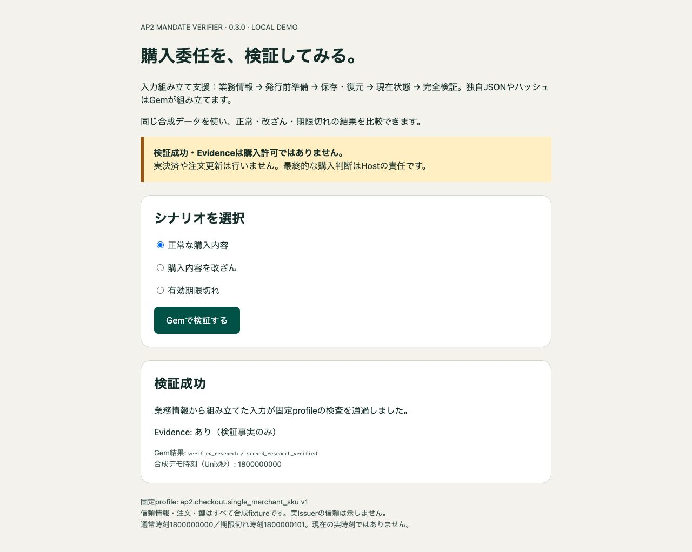

# AP2 Mandate Verifier Demo

Ruby／Rails開発者向けのローカル専用Railsアプリです。公開済み [ap2_mandate_verifier 0.3.0](https://rubygems.org/gems/ap2_mandate_verifier/versions/0.3.0) の**入力組み立て支援**を通常起動で使い、正常・改ざん・期限切れを実Gemで比較できます。

業務情報 → Challenge発行前準備 → 保存・復元 → 独立した現在状態 → 完全検証を示します。利用者がGem独自のtrust／selection／Host JSONやハッシュを手書きする必要はありません。合成の注文・登録公開鍵・署名原文を使い、署名claimから信頼や期待金額を自己承認しません。

**検証成功・Evidenceは購入許可ではありません。** 実決済、注文更新、実Issuer連携、nonceの実発行・消費や注文CASは行いません。最終業務判断と原子的消費はHostの責任です。



## 3つのシナリオ

| 選択 | 成功・拒否の理由 | 実際のGem結果 | Evidence |
| --- | --- | --- | --- |
| 正常な購入内容 | 業務情報から作った入力が固定profileの検査を通過 | verified_research / scoped_research_verified | あり（検証事実のみ） |
| 購入内容を改ざん | 変更した購入JWTが保存済み発行時情報と不一致 | rejected / host_binding_mismatch | なし |
| 有効期限切れ | 合成時刻が署名済みmandateの期限外 | rejected / invalid_purchase_time | なし |

通常の合成時刻はUnix秒 `1800000000`、期限切れは `1800000101`（署名期限 `1800000100`）です。現在の実時刻は使いません。改ざんでは購入JWTの単価を100から999へ変更し、元署名と保存済みChallengeを維持します。アプリが受け付けるのは3つのscenario識別子だけで、任意token・秘密鍵・URLの入力や取得はありません。

## Dockerで起動

GitとDockerを用意してください。DB・Redis・ホストOSへのRuby／Gemインストールは不要です。初回buildは公式Docker HubとRubyGemsから固定依存を取得し、native extensionをビルドする場合があります。lockやchecksum検査を緩めず、取得・依存・providerの失敗時は停止してください。

```sh
git clone https://github.com/cuichangquan/ap2-mandate-verifier-demo.git
cd ap2-mandate-verifier-demo
docker build --platform linux/arm64 -t ap2-mandate-verifier-demo:local .
docker run --rm --name ap2-mandate-verifier-demo \
  --cpus 1 --memory 512m --pids-limit 128 \
  -p 127.0.0.1:3100:3000 \
  ap2-mandate-verifier-demo:local \
  timeout 3600 bundle exec puma -b tcp://0.0.0.0:3000 -t 1:1 config.ru
```

ブラウザで **http://127.0.0.1:3100/** を開き、正常 → 改ざん → 期限切れの順に「Gemで検証する」を押します。version、status/code、Evidence有無と上表を比較してください。公開はlocalhost限定、Pumaは1thread、最大60分で終了します。DB・セッションの永続化はせず、セッション署名値は起動時に一時生成します。

早めに終了する場合は `docker stop ap2-mandate-verifier-demo`。共有cacheやvolumeをpruneする必要はありません。

## テストと実測範囲

```sh
docker run --rm --network none --cpus 1 --memory 512m --pids-limit 128 \
  ap2-mandate-verifier-demo:local \
  timeout 300 bundle exec ruby test/demo_test.rb
```

2026-10-31 01:37:11–01:38:23 UTCに通常Dockerfileを `--no-cache --pull=false` でfresh buildし、約72秒で成功しました。固定base layerは再利用し、公式Gem・依存を導入するRUNは再実行しています。公開0.3.0の37,376 bytes／SHA256をinstall前と完成image内で照合し、install後のlock不変も確認しました。候補opt-inやローカルGemは使いません。

このimageで **5 tests / 122 assertions / 0 failures / 0 errors**。実Gemによる3ケース、反復、検証不能、CSRF／Origin／Host制限、通常経路がfull.jsonを読まないこと、登録済み失敗Result、画面の0.3.0・入力組み立て支援・code／Evidence表示を確認しました。実ブラウザでも正常 → 改ざん → 期限切れを操作し、上表のstatus/code、Evidence有無、0.3.0表示と候補表示がないことを確認しました。上の画像は今回の正常ケースの実画面です。候補時や[0.2.1以前の実測](docs/HISTORY.md)を今回のPASSに流用せず、[候補・撤回・修正の履歴](CANDIDATE.md)も保持しています。

今回の構成はLinux arm64／MRI4.0.9／Bundler4.0.20／OpenSSL gem4.0.2・library3.5.7です。build RUNは2CPU／2GiB、15分・観測ディスク増加2GiBを停止上限としました。テストはnetwork none／1CPU／512MiB／PIDs128／300秒、previewも1CPU／512MiB／PIDs128・localhost限定・Puma1threadです。共有daemonのlayer処理はRUN制限外で、通信全量・ピークCPU/RSSは未計測です。これは一構成の機能観測であり、他OS／architecture、デモのRuby3.4.12、実Issuer／Host、失効、性能、本番GOは未確認です。

## 固定した構成

- Ruby: MRI **4.0.9** 完全一致。
- Base: 公式 `ruby:4.0.9-trixie`、Linux arm64/v8、digest `sha256:42c18f0c9807ba1349c0253617d7f08ef98b815463b2f7785d97c4efdfd80f4d`。
- Rails components: railties/actionpack **8.0.4**、Puma **6.6.1**、Minitest **5.27.0**。
- Verifier: **0.3.0**。固定依存json **2.19.9**、jwt **3.3.0**、base64 **0.3.0**、openssl **4.0.2**、digest **3.2.1**を維持。

Dockerfileは公式Gemの **37,376 bytes** とSHA256 `b3a31d5a8b0718f1085745dd4d97d85f210ff9a1628798110da9ff382ae546bd` をinstall前に照合し、そのbytesをBundler cacheへ渡します。Gemを再buildしません。公開元は [`877f591`](https://github.com/cuichangquan/ap2-mandate-verifier/tree/877f59195632f74714a60551b6afb22ac81d93e3) です。

これはローカルデモであり、他OS/architecture、実Issuer/Host、鍵失効、性能や本番GOの保証ではありません。製品の[対応契約](https://github.com/cuichangquan/ap2-mandate-verifier/blob/main/docs/SUPPORT_CONTRACT.md)を参照してください。

## APIと業務情報の出所

`app/services/scenario_verifier.rb` が独立した `fixtures/input_builder/` の注文・信頼済み公開登録情報と署名原文を読みます。`InputBuilder.trust` → `prepare` → 保存String → `restore` → 現在状態の再取得 → `verify` が通常経路です。候補opt-inの環境変数・別Gemfile・別Dockerfileは不要になりました。

保存済みB・hash・trust参照を現在値から修復しません。署名原文の順序・末尾を保持します。組み立て成功だけでEvidenceは返らず、`InputBuilder.verify` は既存の `verify_checkout` 完全検証へ接続します。既存7入力API・固定profile・Result/Evidence v2契約は維持されています。

業務情報の明示的な対応付けと単体Ruby例は[英語](https://github.com/cuichangquan/ap2-mandate-verifier/blob/main/docs/INPUT_BUILDER.md)／[日本語](https://github.com/cuichangquan/ap2-mandate-verifier/blob/main/docs/INPUT_BUILDER.ja.md)を参照してください。合成署名原文は固定の上流FULLデータ由来で、完成済みfull.jsonは通常経路から除去しました。[MIT License](LICENSE)、[出所・通知](THIRD_PARTY_NOTICES.md)、[業務fixtureの通知](fixtures/input_builder/NOTICE.md)を保持しています。

0.2.1までの3ケースを紹介する[過去のZenn記事](https://zenn.dev/ccq/articles/7f9643f96fe5c7)は、入力組み立て支援導入前の履歴です。現在のコードはこのREADMEを参照してください。実行ログ・依存archive・一時セッション署名値はリポジトリに含めません。
