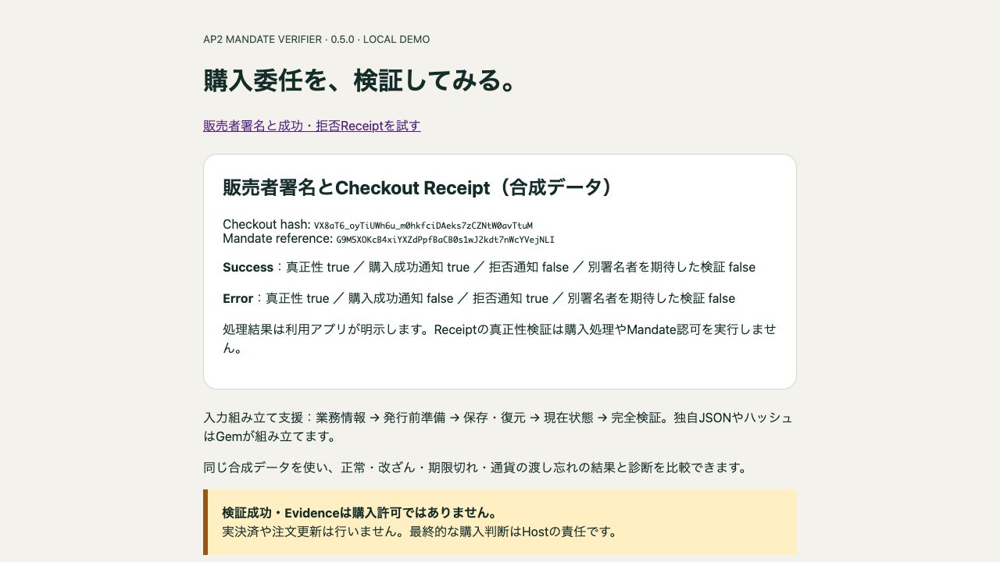

# AP2 購入委任・販売者署名のローカルデモ

公開済み [ap2_mandate_verifier 1.0.0](https://rubygems.org/gems/ap2_mandate_verifier/versions/1.0.0) を通常起動で使うRailsデモです。InputBuilderの検証・診断・Evidence、販売者のCheckout JWT署名、複数商品・数量、真正なSuccess／Error Receiptを試せます。

## 条件付き購入委任はRuby単体例から

1.0.0は0.8.0の公開API・動作・profile・保存形式を維持した1.x契約です。
このデモは既存APIを使うため、依存version/checksum以外のソース移行は不要です。
[1.x公開API・失敗契約](https://github.com/cuichangquan/ap2-mandate-verifier/blob/main/docs/PUBLIC_API.md)と
[0.8.0からの移行](https://github.com/cuichangquan/ap2-mandate-verifier#upgrading-from-080)を参照してください。
`ConditionalCheckout.issue_open/issue_closed/present` を使い、
A／Bから1個＋Cを2個という条件の承認→Open発行→Agent Closed→完全検証→Receipt確認を
Rubyだけで組み立てられます。[同梱の完全実行例](https://github.com/cuichangquan/ap2-mandate-verifier/blob/main/examples/conditional_checkout.rb)と
[短いRelease例](https://github.com/cuichangquan/ap2-mandate-verifier/blob/main/docs/RELEASE_100.md)を主な導入経路にしてください。

```sh
gem install ap2_mandate_verifier --version 1.0.0
ruby "$(ruby -e 'puts Gem::Specification.find_by_name("ap2_mandate_verifier", "1.0.0").full_gem_path')/examples/conditional_checkout.rb"
```

以下のRails画面は既存のOpen→Agent Closed検証・販売者署名／Receiptの合成シナリオです。
条件承認・Open発行・Agent Closed生成のUIや、本人認証・Provider鍵管理を実装した画面ではありません。

## Dockerで起動

GitとDockerを用意してください。DB・Redis・ホストへのRuby導入、環境変数や候補Gemfileの指定は不要です。

```sh
git clone https://github.com/cuichangquan/ap2-mandate-verifier-demo.git
cd ap2-mandate-verifier-demo
docker build --platform linux/arm64 -t ap2-mandate-verifier-demo:local .
docker run --rm --name ap2-mandate-verifier-demo \
  --cpus 1 --memory 512m --pids-limit 128 -p 127.0.0.1:3100:3000 \
  ap2-mandate-verifier-demo:local \
  timeout 3600 bundle exec puma -b tcp://0.0.0.0:3000 -t 1:1 config.ru
```

http://127.0.0.1:3100/ で従来の4検証ケースを選びます。「販売者署名と成功・拒否Receipt」と「複数商品・数量」のリンクから、各APIの結果を比較できます。画面の1.0.0・status/code・診断・Evidence・Receiptの真正性と業務結果を確認してください。終了は `docker stop ap2-mandate-verifier-demo`。Web公開や共有cacheのpruneは行いません。

| ケース | 結果 |
| --- | --- |
| 正常 | verified_research / scoped_research_verified、Evidenceあり |
| 購入内容を改ざん | rejected / host_binding_mismatch、Evidenceなし |
| 期限切れ | rejected / invalid_purchase_time、Evidenceなし |
| 通貨を渡し忘れる | rejected / invalid_host_context、order.currency診断、Evidenceなし |
| Merchant署名・Success Receipt | 真正性true、購入成功通知true |
| Merchant署名・Error Receipt | 真正性true、購入成功通知false、拒否通知true |
| Coffee2個＋Tea3個 | 明示的な複数明細profileで検証成功、Evidenceあり |
| 2件目をTea2個へ減らす | 真正署名・金額一致でも constraint_mismatch、Evidenceなし |

## 複数商品・数量

http://127.0.0.1:3100/multi-item はCoffee2個＋Tea3個の成功と、Tea2個だけの不足を比較します。真正なSuccess／Error Receiptも表示し、Errorでも署名検証はtrue、購入成功通知はfalseになります。

ページは入力構築・prepare・保存・restore・現在状態のverify・Checkout署名・Receipt署名と検証を公開APIで実行します。Issuer／Agent envelopeはデモ内の合成試験処理で、製品発行APIではありません。

明示profileは `ap2.checkout.single_merchant_multi_item` v1です。最大8明細・8要件・各8候補、商品IDで数量を完全割当てし、要件IDと明細IDは別です。同じ商品の複数行を保持し、候補の重なりを支持し、余剰・不足・二重充当を拒否します。旧 `ap2.checkout.single_merchant_sku` v1は通常4ケースで引き続き利用し、定義と受理範囲は変えていません。

税／送料／割引・複数販売者・実決済は対象外です。[複数明細契約](https://github.com/cuichangquan/ap2-mandate-verifier/blob/main/docs/MULTI_ITEM_CHECKOUT.md)、[公式Python SDKとの差異](https://github.com/cuichangquan/ap2-mandate-verifier/blob/main/docs/MULTI_ITEM_INTEROP.md)、[今回の公開Gem検証](docs/PUBLISHED_100.md)を参照してください。

**EvidenceもReceipt真正性も購入・決済の実行許可ではありません。** 業務結果はアプリが明示し、実決済・注文更新・nonce消費は行いません。すべて合成データ・メモリ内テスト鍵で、実Issuerの信頼を示しません。固定時計は1800000000、期限切れケースは1800000101です。

## テスト

```sh
docker run --rm --network none --cpus 1 --memory 512m --pids-limit 128 \
  ap2-mandate-verifier-demo:local sh -c \
  'timeout 120 bundle exec ruby test/demo_test.rb && timeout 60 bundle exec ruby test/merchant_scenario_test.rb && timeout 60 bundle exec ruby test/multi_item_scenario_test.rb'
```

公開1.0.0のfresh build・今回の実測結果は[公開Gem検証記録](docs/PUBLISHED_100.md)へ記録します。過去の候補試験を今回のPASSとして数えません。

## 固定構成・責任境界

MRI4.0.9、Bundler4.0.20、railties/actionpack8.0.4、Puma6.6.1、Minitest5.27.0。Docker baseは既存の公式arm64 digestに固定しています。Verifier1.0.0とJSON2.19.9／JWT3.3.0／base640.3.0／OpenSSL gem4.0.2／Digest3.2.1を使用します。

Dockerfileは公式Gemの **102,912 bytes** とSHA256 `a107101b0178c54ba417be7a2bd7e22feb2fd9a07bda089043e8c5ea8e65e12b` を導入前に照合し、同じbytesをBundler cacheへ渡します。通常導入後も全33ファイルのarchive/installed一致、依存・Ruby要件、source外からのロードを検査します。Gemは再buildしません。公開sourceは [`59e344a`](https://github.com/cuichangquan/ap2-mandate-verifier/tree/59e344ad865ed867d0993120456f9411d82bcdec)。取得／provider／依存の失敗時は停止し、lockやchecksumを緩めません。

`ScenarioVerifier` は独立した業務情報と署名原文からprepare→保存→restore→現在状態→verifyを行います。保存したB／digestを現在値へ修復せず、利用者入力から鍵・期待注文を推測しません。

[対応契約](https://github.com/cuichangquan/ap2-mandate-verifier/blob/main/docs/SUPPORT_CONTRACT.md)／[Merchant API・仕様とSDK差異](https://github.com/cuichangquan/ap2-mandate-verifier/blob/main/docs/MERCHANT_SIGNING.md)／[過去の候補・実測履歴](docs/HISTORY.md)。実Issuer・Host本番・原子的nonce消費・失効・性能・Web運用等のHOLDは維持します。他OS／architectureやデモのRuby3.4.12は未検証です。[MIT](LICENSE)、[出所通知](THIRD_PARTY_NOTICES.md)、[業務fixture通知](fixtures/input_builder/NOTICE.md)を保持します。実行ログ・依存archive・一時セッション鍵はコミットしません。

## 開発source比較用の候補手順

通常利用は上記Dockerfileだけで完結します。`Dockerfile.candidate`／`Gemfile.candidate` はローカルsourceの比較用として別経路に残しています。公開Gemと同じversion表示でもそのbuild物は公開bytesの証明にならず、公開Gemの代用にしません。この公開後整備では候補Gemをbuildしません。

この比較経路は歴史的な0.6.0 source用です。`Gemfile.candidate.lock`を専用に使い、
1.0.0の通常起動lockと混ぜません。現行1.0.0 sourceの候補build手順ではありません。

過去の候補起動・試験は[0.6.0候補の歴史記録](docs/MULTI_ITEM_CANDIDATE.md)へ、さらに古い候補は[CANDIDATE.md](CANDIDATE.md)へ残しています。



## Direct購入側API（0.7.0から継続）

1.0.0は`CheckoutJWT.verify`、`Buyer.issue_closed/present_closed/verify`と
Direct Receipt profileを公開しています。[承認→発行→提示→販売者検証→Receipt確認の完全実行例](https://github.com/cuichangquan/ap2-mandate-verifier/blob/main/examples/direct_checkout.rb)と
[API契約](https://github.com/cuichangquan/ap2-mandate-verifier/blob/main/docs/BUYER_DIRECT_CHECKOUT.md)を参照してください。
1販売者・1〜8明細・複数商品に対応します。

このRails画面は既存のOpen→Agent Closed検証と販売者署名／Receiptの合成シナリオを維持しています。
Directの本人認証・承認UI・Provider鍵管理を実装した画面ではありません。
本人認証・購買権限・保護された承認記録・永続一意制約／原子処理・結果不明時の照会は利用アプリの責任です。
Gem検証やデモ受理は実購入・実決済成功を意味しません。
