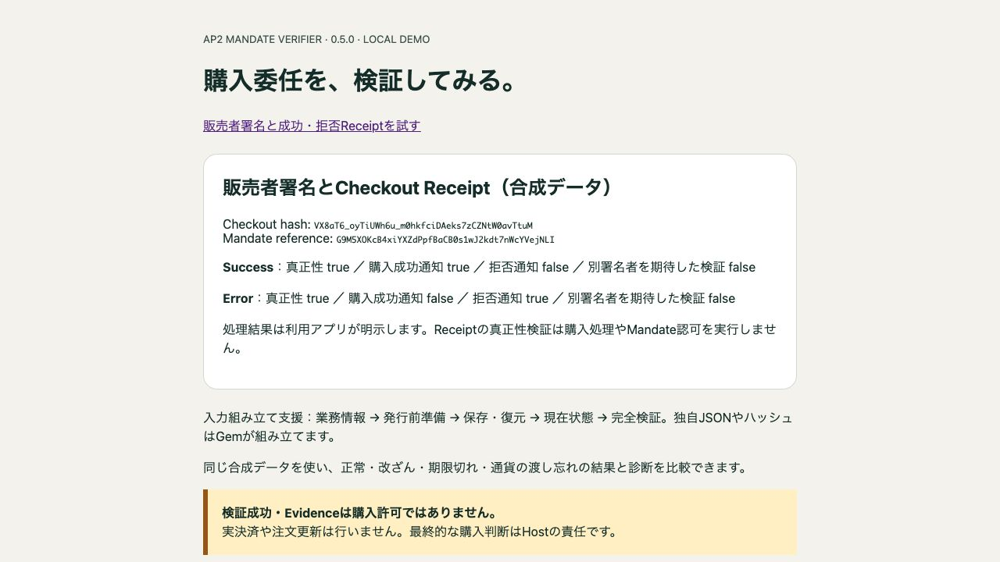

# AP2 購入委任・販売者署名のローカルデモ

公開済み [ap2_mandate_verifier 0.5.0](https://rubygems.org/gems/ap2_mandate_verifier/versions/0.5.0) を使うRailsデモです。通常画面でInputBuilderの検証・診断・Evidenceと、販売者のCheckout JWT署名・成功／拒否Receiptを試せます。

| ケース | 結果 |
| --- | --- |
| 正常 | verified_research / scoped_research_verified、Evidenceあり |
| 購入内容を改ざん | rejected / host_binding_mismatch、Evidenceなし |
| 期限切れ | rejected / invalid_purchase_time、Evidenceなし |
| 通貨を渡し忘れる | rejected / invalid_host_context、order.currency診断、Evidenceなし |
| Merchant署名・Success Receipt | 真正性true、購入成功通知true |
| Merchant署名・Error Receipt | 真正性true、購入成功通知false、拒否通知true |



**EvidenceもReceipt真正性も購入・決済の実行許可ではありません。** 業務結果はアプリが明示し、実決済・注文更新・nonce消費は行いません。すべて合成データ・メモリ内テスト鍵で、実Issuerの信頼を示しません。固定時計は1800000000、期限切れケースは1800000101です。

## Dockerで起動

GitとDockerを用意してください。DB・Redis・ホストへのRuby導入は不要です。

```sh
git clone https://github.com/cuichangquan/ap2-mandate-verifier-demo.git
cd ap2-mandate-verifier-demo
docker build --platform linux/arm64 -t ap2-mandate-verifier-demo:local .
docker run --rm --name ap2-mandate-verifier-demo \
  --cpus 1 --memory 512m --pids-limit 128 -p 127.0.0.1:3100:3000 \
  ap2-mandate-verifier-demo:local \
  timeout 3600 bundle exec puma -b tcp://0.0.0.0:3000 -t 1:1 config.ru
```

http://127.0.0.1:3100/ で4検証ケースを選び、「販売者署名と成功・拒否Receipt」リンクで新機能を比較します。画面の0.5.0・status/code・診断・Evidence・Receiptの真正性と業務結果を確認してください。環境変数・候補Gemfileは不要です。終了は `docker stop ap2-mandate-verifier-demo`。Web公開や共有cacheのpruneは行いません。

## テスト

```sh
docker run --rm --network none --cpus 1 --memory 512m --pids-limit 128 \
  ap2-mandate-verifier-demo:local \
  sh -c 'timeout 120 bundle exec ruby test/demo_test.rb && timeout 60 bundle exec ruby test/merchant_scenario_test.rb'
```

2026-10-31 UTCのfresh buildで公式Gem hash/sizeとlock不変を確認し、7 tests / 173 assertions＋Merchant API 1 test / 13 assertionsが合格。実ブラウザで正常・改ざん・期限切れ・通貨不足とSuccess/Error Receipt、0.5.0表示を確認しました。過去の試験件数を今回のPASSへ転記していません。

## 固定構成・責任境界

MRI4.0.9、Bundler4.0.20、railties/actionpack8.0.4、Puma6.6.1、Minitest5.27.0。Docker baseは既存の公式arm64 digestに固定しています。Verifier0.5.0とJSON2.19.9／JWT3.3.0／base640.3.0／OpenSSL gem4.0.2／Digest3.2.1を使用します。

Dockerfileは公式Gemの **50,688bytes** とSHA256 `00b0ce0981070864c67a056906c5af204bbc5aaa80d029cb4a64294634367dd8` を導入前に照合し、同じbytesをBundler cacheへ渡します。Gemは再buildしません。公開sourceは [`bf796a5`](https://github.com/cuichangquan/ap2-mandate-verifier/tree/bf796a53600c189b0cfe66c9cfcd1de8a353c03d)。取得／provider／依存の失敗時は停止し、lockやchecksumを緩めません。

`ScenarioVerifier` は独立した業務情報と署名原文からprepare→保存→restore→現在状態→verifyを行います。保存したB/hash/trustを現在値で修復しません。診断は `result.diagnostic&.to_h(locale: :ja)`、Evidenceは検証事実のみです。`MerchantScenario` のinline envelopeはテスト専用で、製品のMandate発行APIや利用者認可ではありません。Receiptは期待署名者・信頼鍵・明示時計・対象原文referenceを照合し、真正な拒否を購入成功へ変換しません。

[対応契約](https://github.com/cuichangquan/ap2-mandate-verifier/blob/main/docs/SUPPORT_CONTRACT.md)／[Merchant API・仕様とSDK差異](https://github.com/cuichangquan/ap2-mandate-verifier/blob/main/docs/MERCHANT_SIGNING.md)／[過去の候補・実測履歴](docs/HISTORY.md)。実Issuer・Host本番・原子的nonce消費・失効・性能・Web運用等のHOLDは維持します。他OS／architectureやデモのRuby3.4.12は未検証です。[MIT](LICENSE)、[出所通知](THIRD_PARTY_NOTICES.md)、[業務fixture通知](fixtures/input_builder/NOTICE.md)を保持します。実行ログ・依存archive・一時セッション鍵はコミットしません。
