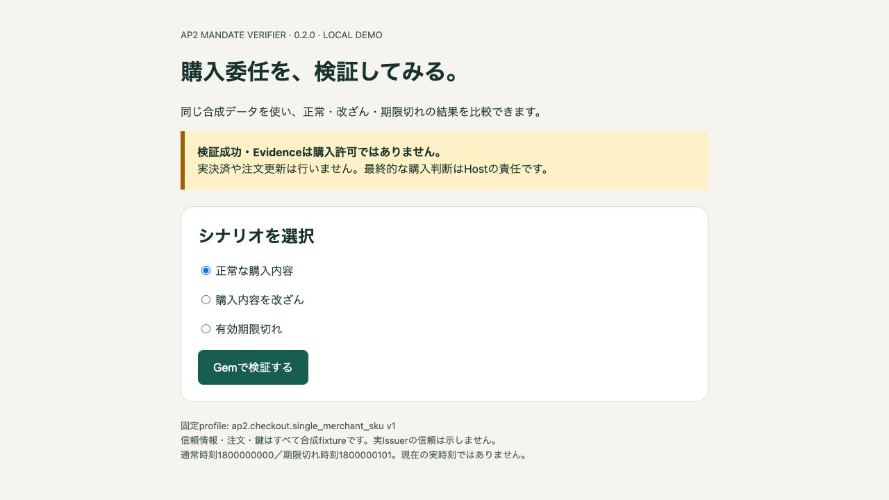
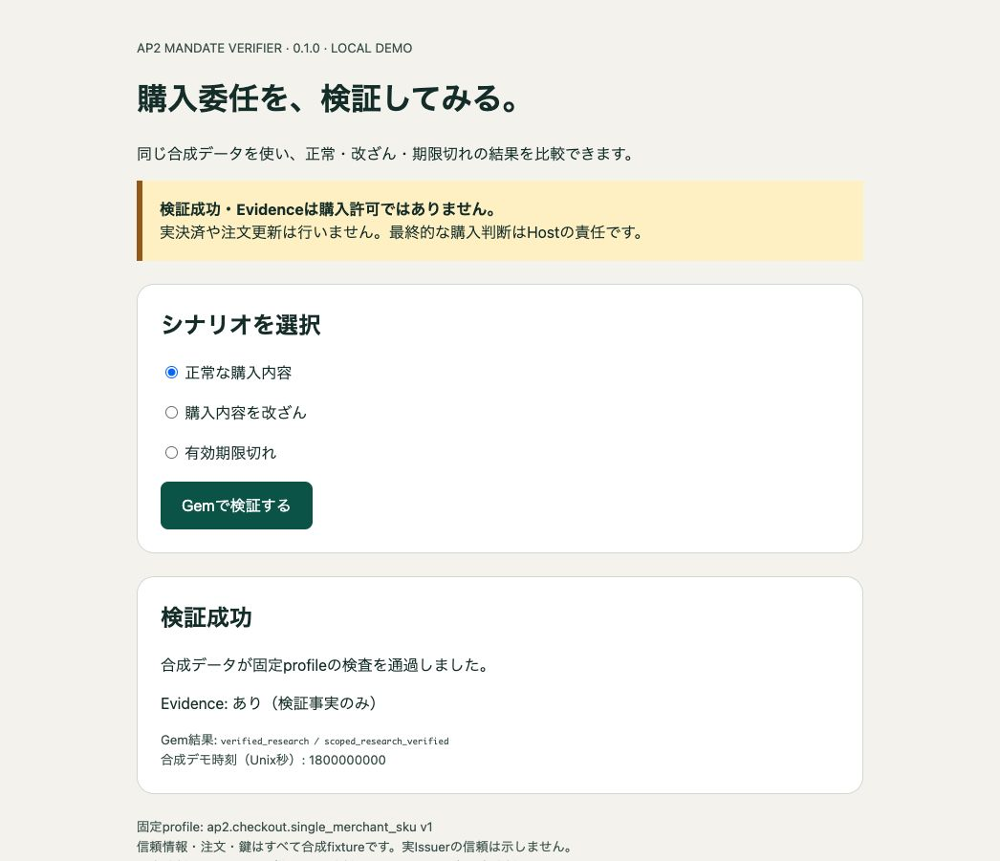

# AP2 Mandate Verifier Demo

Ruby／Rails開発者が、購入委任の「検証成功」と「拒否の理由」をブラウザで比較できる、小さなローカル専用Railsアプリです。[ap2_mandate_verifier 0.1.0](https://rubygems.org/gems/ap2_mandate_verifier/versions/0.1.0) を実際に呼び、正常・改ざん・期限切れの3ケースを試せます。Gemを自分のアプリへ組み込む前に、返される結果と責任境界を確認できます。

実際の3ケースを画面とコードで紹介する[Zennの解説記事](https://zenn.dev/ccq/articles/7f9643f96fe5c7)も公開しています。

**検証成功・Evidenceは購入許可ではありません。** 実決済、注文更新、実Issuer連携、nonce消費や注文CASは行いません。



## 3つのシナリオ

| 選択 | 成功・拒否の理由 | 実際のGem結果 | Evidence |
| --- | --- | --- | --- |
| 正常な購入内容 | 合成データが固定profileの検査を通過 | verified_research / scoped_research_verified | あり（検証事実のみ） |
| 購入内容を改ざん | 購入内容と保存済みHost情報が不一致 | rejected / host_binding_mismatch | なし |
| 有効期限切れ | 合成デモ時刻が有効期間の条件を満たさない | rejected / invalid_purchase_time | なし |

画面には日本語の結果・理由、Gemのstatus/code、Evidenceの有無、評価した合成時刻を表示します。エラーで検証を完了できない場合は「検証不能」とし、成功や購入許可として扱いません。

正常ケースの実画面です。スクリーンショットは実行中のlocalhost UIを撮影したもので、生成したモック画像ではありません。



入力は保存済みの**合成fixture**です。信頼情報・注文・公開鍵もテスト専用で、実Issuerの信頼を示しません。現在時刻は使いません。

- 通常の評価時刻: Unix秒 `1800000000`。
- 期限切れの評価時刻: `1800000101`。署名済みmandateの期限は `1800000100`。
- 改ざんは購入JWTの単価を100から999へ変更し、元署名とHost bindingを維持します。Host bindingで先に拒否される例です。

アプリが受け付けるのは固定の3つのscenario識別子だけです。任意token、秘密鍵、URLの入力・取得はありません。

## Dockerで起動

GitとDocker DesktopまたはDocker Engineを用意し、以下のclone → build → runで起動します。DB・Redis・秘密鍵の準備や、ホストOSへのRuby／Gemのインストールは不要です。

この手順はLinux arm64/v8のイメージを固定して使います。他architectureでの動作は未検証です。また、**この公開Dockerfileからのfresh buildは未実施**です。過去に動作確認した取得コンテナ由来のイメージと区別してください（詳細は「テストと実測範囲」）。

初回のビルドは公式Docker HubとRubyGems/CDNからイメージと依存を取得し、native extensionをビルドする場合があります。ネットワーク接続と追加ディスクが必要です。Gemfile.lockの固定条件を緩めず、取得・依存・providerの失敗時は停止してください。

```sh
git clone https://github.com/cuichangquan/ap2-mandate-verifier-demo.git
cd ap2-mandate-verifier-demo
docker build --platform linux/arm64 -t ap2-mandate-verifier-demo:local .
docker run --rm --name ap2-mandate-verifier-demo \
  --cpus 1 --memory 512m --pids-limit 128 \
  -p 127.0.0.1:3100:3000 \
  ap2-mandate-verifier-demo:local \
  timeout 3600 bundle exec puma -b tcp://0.0.0.0:3000 -t 1:1 config.ru
```

ブラウザで **http://127.0.0.1:3100/** を開き、正常 → 改ざん → 期限切れの順に選び、それぞれ「Gemで検証する」を押します。上の表と画面の結果・理由を比較してください。ホスト側の公開はlocalhostだけです。コンテナ内部のPumaは0.0.0.0:3000で待受します。最大60分で終了し、`--rm`でコンテナを削除します。

DB、Redis、バックグラウンドサービス、JavaScriptビルドは不要です。セッション署名値は起動時に一時生成し、再起動すると以前のセッションは無効になります。鍵を入力・保存する設定はありません。

早めに終了する場合は別ターミナルから実行します。イメージを再利用しない場合だけ最後のコマンドを実行してください。

```sh
docker stop ap2-mandate-verifier-demo
docker image rm ap2-mandate-verifier-demo:local
```

共有cacheやvolumeをpruneする必要はありません。

## テストと実測範囲

```sh
docker run --rm --network none --cpus 1 --memory 512m --pids-limit 128 \
  ap2-mandate-verifier-demo:local \
  timeout 300 bundle exec ruby test/demo_test.rb
```

2026-10-26のローカル検査で **3 tests / 82 assertions / 0 failures / 0 errors**。実Gemによる3ケース、反復と状態分離、安全なエラー理由、Evidenceの有無、フォーム、CSRF/Origin、Host制限、不明scenario拒否を確認しました。実HTTPとブラウザでも正常 → 改ざん → 期限切れ → 正常を確認しました。

初回ブラウザ確認でno-referrerによるnull Originの422を発見し、same-originへ修正して再テストしました。CSRF保護は有効です。公開準備時に固定のデモ署名値を一時生成へ置き換えました。

今回の実測イメージは、既存のdigest固定Rubyイメージを使う取得コンテナから作成したものです。**この公開Dockerfileからのfresh buildは未実施**です。新規環境でのビルド、他OS/architecture、一般的な本番互換性は検証していません。

## 固定した構成

- Ruby: MRI **4.0.9** 完全一致。
- Base: 公式 `ruby:4.0.9-trixie`、Linux arm64/v8、digest `sha256:42c18f0c9807ba1349c0253617d7f08ef98b815463b2f7785d97c4efdfd80f4d`。
- Rails components: railties/actionpack **8.0.4**。Puma **6.6.1**、Minitest **5.27.0**。
- Verifier: **0.1.0**。固定依存json **2.19.9**、jwt **3.3.0**、base64 **0.3.0**、openssl **4.0.2**、digest **3.2.1**を維持。
- ローカルで観測したBundlerは4.0.20、OpenSSL libraryは3.5.7。lockには複数platformの63 specs、実インストールは49 Gemsでした。

これは**Linux arm64・そのprovider・Railsの組合せにおけるデモ限定の実測**です。製品Gemの支持環境や保証を変更しません。製品の正確な対応範囲は[公式SUPPORT_CONTRACT](https://github.com/cuichangquan/ap2-mandate-verifier/blob/v0.1.0/docs/SUPPORT_CONTRACT.md)を参照してください。

Dockerfileは公開Gem archiveが **34,304 bytes**、SHA256が `37b2a235b6fab2d9d9765ae985dd9db27afd3b2c5407fe263a6b65314550db32` であることをinstall前に照合し、チェックしたbytesをBundler cacheへ渡します。

## APIとfixtureの出所

`app/services/scenario_verifier.rb` が毎回新しいfixtureを読み、次の公開APIへ7入力を渡します。旧verify APIや模擬成功結果は使いません。

```ruby
AP2MandateVerifier.verify_research(
  trust_json:, selection_json:, host_json:,
  root_presentation:, terminal_jws:, host_checkout_jws:, verified_at:
)
```

fixtureは[上流の固定commit](https://github.com/cuichangquan/ap2-mandate-verifier/blob/f6d4f83d396b75505256dba5769a54a8f065eeea/research/stage15/results/R3/INPUTS.json)のFULLのみを抽出しました。読み込み時にSHA256を確認します。

- 上流原本: `41ad845a7ea82a9c7316c9ef11fb8ee5281453afafe2b4932c7217c1936562c1`。
- 同梱full.json: `ac98f3b0c475365e2e7416cbb1838f1692a0ff2693c71dba0cb664c52b9ad42f`。

公開鍵と合成の署名済み入力のみを同梱しています。[MIT License](LICENSE)と[fixtureの出所・通知](THIRD_PARTY_NOTICES.md)を参照してください。ローカルログ、実行環境の機械情報、依存archive、セッション署名値はリポジトリに含めません。
