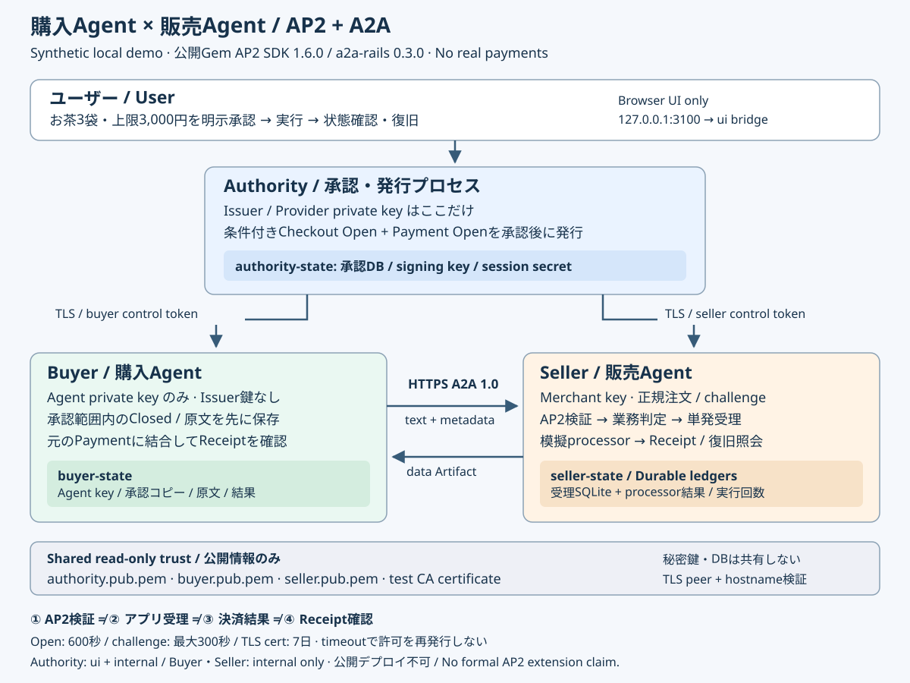

# 購入Agent × 販売Agent: AP2 / A2A ローカル実通信デモ

このデモは「お茶3袋、合計3,000円以下」というユーザーの明示承認を、購入Agentと販売Agentの**別プロセス間のHTTPS通信**につなぎます。承認・検証・受理・模擬決済・Receipt確認を分けて観察します。

**合成データだけを使います。実際のお金は動きません。外部LLM、決済口座、実カード、外部Issuer、クラウドサービスは不要です。** 既存の単体検証画面とは別のCompose構成です。既存READMEの手順・例はそのまま使えますが、両方がlocalhostの3100番を使うので同時起動しないでください。



## 1. 起動と最初の購入

**公開Gemの依存関係は`Gemfile.purchase.lock`に固定済みです。Apple SiliconのDockerでbuild・全シナリオ・実画面を確認しました。** ローカル検証の範囲は[検証台帳](PURCHASE_VALIDATION.md)、最終commitのCI・独立レビュー・統合結果は対応するPRのChecksとレビュー記録を参照してください。

前提はGit、DockerとComposeです。MacへRubyやGemを直接インストールする必要はありません。リポジトリ直下で実行します。

```sh
export COMPOSE_PROJECT_NAME=ap2-purchase-demo
docker compose -f compose.purchase.yml up --build
```

以降の操作も同じターミナル、または同じ`COMPOSE_PROJECT_NAME`を設定したターミナルで行います。プロジェクト名を変えると別のvolume・購入履歴になります。

初回の`init`が役割ごとの秘密鍵、短期テスト証明書、ランダムな認証トークン、SQLiteデータを作成します。後続の`authority`、`buyer`、`seller`は別プロセスで起動します。

1. http://127.0.0.1:3100/ を開きます。
2. 正常系を選び、商品「お茶」、数量3袋、上限3,000円、販売者・模擬支払手段を確認します。
3. 承認チェックを入れて承認を保存します。この時点では購入を実行しません。
4. 同じ購入IDの「実行」を押します。正常な提示は3袋×800円＝2,400円です。
5. AP2検証、アプリ受理、模擬決済、Receipt確認の各表示と実行回数を確認します。

初回起動時は他サービスの起動が間に合わず通信失敗になる場合があります。承認が保存されていれば同じ購入IDで続行します。新しい承認を発行して回避しないでください。

## 2. 八つのシナリオ

以下は期待する結果です。八つのシナリオは別プロセス間の実TLS/A2A統合テストで確認済みです。ブラウザでも全八ケースを確認済みです。最終commitのCI・レビュー結果は対応するPRに記録します。[検証記録](PURCHASE_VALIDATION.md)で範囲を区別しています。

| 選択 | 注入する状況 | 観察する結果 |
| --- | --- | --- |
| `valid` | お茶3袋、2,400円 | 検証・受理・模擬成功・購入側の真正なSuccess確認 |
| `budget` | 3袋×1,200円＝3,600円 | 3,000円上限を超え、Payment発行を拒否。決済未開始 |
| `quantity` | 3袋の承認に対して2袋を提示 | Checkout発行を拒否。決済未開始 |
| `tampered` | Checkout terminal署名を改ざん | 販売側が拒否。決済未開始 |
| `error` | 模擬決済がErrorを返す | 真正なError Receiptでも購入成功ではない。承認再利用不可 |
| `timeout` | 模擬結果保存後に応答を遅延 | 応答不明。元の購入IDで照会・復旧し、実行回数は1を維持 |
| `wrong_receipt` | 別のpayment IDの署名付きReceiptを配信 | 購入側は成功と認めない。再決済もしない |
| `invalid_receipt` | Receiptの署名を破損 | 購入側は成功と認めない。再決済もしない |

正常系を含めて八つです。画面には秘密鍵、トークン、SD-JWT/JWS原文を出しません。異常系でもアプリが保持する本来の注文・Receiptは書き換えず、指定箇所に合成障害を注入します。

## 3. Replay、timeout、再起動

### 同じ購入を再実行する

成功またはErrorが確定した**同じ購入ID**で再度実行します。購入側は最初に保存した原文を再利用します。販売側は既存の受理レコードを照会し、新規の決済を開始しません。模擬processorの実行回数が1のままであることを確認してください。新しく承認した購入は別IDなので、replay試験にはなりません。

### 応答不明を復旧する

`timeout`では販売側が模擬processor結果を永続化した後、受理状態を`unknown`にして3秒待ちます。クライアントのread timeoutは2秒です。これはネットワーク境界を通る実際の応答timeoutを狙った障害注入です。

- 同じ購入IDで状態を更新し、復旧を選びます。
- 保存済みのprocessor結果とReceiptを使って`reconcile`します。
- 許可の更新、新しいOpen、別の決済キー、再決済は行いません。
- 「模擬成功」の通知だけで終了せず、購入側Receipt確認も確認します。

### buyer / sellerの再起動

```sh
docker compose -f compose.purchase.yml restart buyer seller
```

同じブラウザセッションの購入ページへ戻り、状態更新・復旧を試します。鍵・承認・原文・受理台帳・processor結果は各named volumeに残ります。A2A自身のTaskは標準MemoryStoreのためプロセス再起動で消えますが、購入の復旧は独立した永続購入IDを使います。

### 停止とデータの扱い

```sh
docker compose -f compose.purchase.yml down
```

通常の`down`はnamed volumeを保持します。次の`up`で初期化済みデータを使います。部分的な初期化やDB欠損を、新しい鍵・空の台帳の自動作成で修復しません。

**全履歴を捨てて初めからやり直すとユーザーが決めた場合だけ**、次を実行します。鍵、承認、台帳、processor結果、セッション秘密値が削除され、以前の購入は復旧できなくなります。

```sh
# 破壊的な全リセット。通常の停止・再起動には使わない。
docker compose -f compose.purchase.yml down -v
```

共有Docker cacheや他プロジェクトを削除する`prune`は不要です。

## 4. 三つの役割と権限

| プロセス | 持つ秘密・状態 | できること / できないこと |
| --- | --- | --- |
| authority | Issuer/Provider署名鍵、承認DB、session secret、buyer/seller control token | 明示承認後に条件付きOpenを発行し、両Agentへ保護されたcontrol通信で配布。購入AgentへIssuer鍵を渡さない |
| buyer | Agent署名鍵、承認の写し、最初の提示原文、seller A2A token、自身のcontrol受信token | 承認範囲内でClosedを作り、販売側A2Aへ送信。Openを発行できずseller control tokenも持たない |
| seller | Merchant/合成Receipt署名鍵、正規注文、challenge、受理台帳、processor結果、A2A/control受信token | 注文提示、AP2検証、業務判定、単発受理、模擬実行、Receipt発行。Issuer鍵とAgent秘密鍵を持たない |

`authority-state` / `buyer-state` / `seller-state`は各プロセスにだけ`/state`としてマウントします。公開鍵とCA証明書だけを`public-trust`から`/trust:ro`に共有します。`init`だけが初期作成のため全volumeへアクセスし、ネットワークなしで終了します。CA秘密鍵はinitのメモリだけに存在し、保存しません。

`PURCHASE_STATE_DIR=/state`、`PURCHASE_TRUST_DIR=/trust`が境界です。通常プロセスは非root・read-only filesystem、capabilityなし、CPU 0.75 / メモリ384MiB / PID64の上限を持ちます。DB用volumeだけは更新できます。

## 5. 四つの判定を混同しない

1. **AP2検証**: 署名、委任先、承認条件、merchantの注文、challenge、CheckoutとPaymentの結合を検証します。
2. **アプリの受理**: 現在の保護された承認、数量、予算、注文状態を確認し、永続台帳の`authorize!` → `accept` → `start`で単発実行を制御します。
3. **模擬決済の結果**: 別の永続processorレコードに結果を保存します。検証に成功しても決済成功とは限りません。timeoutでも成功済みの可能性があります。
4. **購入側のReceipt確認**: 署名・発行者・payment ID・元のPaymentとの結合を検証します。真正なErrorは失敗、別取引または不正署名は成功未確認です。

承認保存はこれら四段階より前です。承認に使う正規データはauthority側、注文とchallengeはseller側が保持し、受信した自己申告だけから信頼・正規注文を組み立てません。

## 6. プロトコルとコードの対応

使用する公開Gemは`ap2_mandate_verifier = 1.6.0`と`a2a-rails = 0.3.0`です。`Gemfile.purchase` / lockfileを使い、SDKソース差し替えやGemの変更はしません。

- AP2の参照元は**v0.2.0、commit `b4587ac1d055888a73b4b21750973cffba961793`固定**です。合成デモの結果を一般的なAP2準拠や実Issuer由来の証明として扱いません。
- Checkoutは`AP2MandateVerifier::ConditionalCheckout::PROFILE_REF`（`ap2.checkout.single_merchant_multi_item`）のmulti-item条件付きprofileです。この例の商品種類はお茶1種ですが、同profileの数量要件を使います。
- Paymentは`AP2MandateVerifier::Payment::PROFILE_REF`（`ap2.payment.single.complete.1`）の標準Payment profileです。SDKの`verified_research`等の判定範囲を本番認証・全面的な仕様適合へ読み替えません。
- A2Aは**protocol 1.0**、JSON-RPC 2.0 envelope、`A2A-Version: 1.0`です。Gem 0.3.0はA2A protocol 0.3を意味しません。
- `SendMessage`のtext Partをコマンド、`message.metadata.purchase_demo`をAP2 payloadに使い、Hash結果をTaskのdata Artifactで返す**アプリ定義profile**です。
- a2a-rails 0.3.0サーバーはtext入力を受け、メタデータを保持します。正式なAP2 DataPart入力、Agent Card extension宣言、extension negotiationは実装していません。**正式なAP2 A2A extension対応とは主張しません。**

| ファイル | 役割・主なAPI |
| --- | --- |
| `purchase_demo/authority_application.rb` / `authority.rb` | CSRF・同一ブラウザ購入IDの確認、明示承認、保護されたprovision / run / recover |
| `purchase_demo/protocol.rb` | `ConditionalCheckout.issue_open/issue_closed/present`、`Payment.issue_open/issue_closed/present/verify`、`InputBuilder.prepare/restore/inputs`、`PaymentReceipt.sign/verify` |
| `purchase_demo/buyer.rb` | 正確な初回原文の保存、offer / purchase / status / recover、購入側Receipt検証 |
| `purchase_demo/seller_application.rb` | `A2A::Rails::Agent`単一skill、`PurchaseHandler.call(message:, context:)`、別tokenの`/control` |
| `purchase_demo/seller.rb` | `Runtime.seller.call(command,payload)`、`provision(payload)`、`PaymentAcceptance::Service`のlookup / accept / start / finish / unknown / reconcile |
| `purchase_demo/store.rb` | 役割別DB、購入IDとprocessor keyの一意性、SDK SQLite受理台帳 |
| `purchase_demo/transport.rb` | authorityの`request(service:,path:,payload:)`、buyerの`a2a(command:,payload:)`、実HTTPSとJSON-RPC検査 |
| `purchase_demo/setup.rb` / `compose.purchase.yml` | 使い捨てテスト鍵、初期DB、独立プロセス・volume・ネットワーク境界 |

### TLS / SSRFの境界

buyer/sellerはPumaが直接TLSを終端します。専用アプリクライアントは固定の`https://buyer:3443`と`https://seller:3443`、許可されたrouteだけを呼び、外部からURLを受け取りません。Agent Cardのendpointも固定値との完全一致を確認します。

TLS peerとhostnameを検証し、専用CAを使います。環境proxy・redirect・自動retryは禁止。request/responseは128KiB、JSON深さ32、open/read/writeは各2秒、合計8秒が上限です。元のHTTP例外や応答本文を画面へ返しません。

これはDocker内の既知の2サービス向け専用transportであり、任意の外部Agentへ接続する汎用clientではありません。**a2a-railsの本番TLS/SSRF保護は変更せず、private reflection、allow-private設定、VERIFY_NONEは使いません。** buyer/sellerは`purchase`内部ネットワークだけに参加し、ホストへのポート公開はありません。authorityは内部ネットワークに加え、Docker Desktopでlocalhostへのポート公開を成立させる`ui` bridgeにも参加します。公開bindは`127.0.0.1:3100`だけです。authorityまでネットワーク外通信が不可能だとは主張しません。

## 7. 有効期限と制限

- Open承認: 発行から600秒。challenge: 最大300秒かつ承認期限内。時間が過ぎた未実行購入は拒否します。
- テストTLS証明書: 初期化から7日。期限を無視せず、期限切れなら通信失敗になります。更新はこのデモでは自動化していません。
- timeoutや再起動を理由に承認やchallengeを自動延長しません。消費済みの購入の結果照会は新しい支払許可を意味しません。
- Receipt照合の期間は元の承認発行時刻から24時間。復旧も無期限成功を保証しません。
- 台帳のreserved状態でプロセスが停止し、processor結果がまだ無い場合、結果照会はできますが自動再dispatchはしません。明示的な運用判断が必要です。
- 模擬processorは永続レコードによる1回の実行を狙うローカル実装です。実際の決済事業者との分散exactly-once保証ではありません。
- 公開trust情報は合成registryです。実際の本人確認、KMS/HSM、Issuer接続、認証局運用、取消・失効、在庫、精算はありません。
- localhost HTTPのUIには本番のログインやTLS終端がありません。インターネット公開・ポート転送・公開デプロイには使わないでください。

## 8. 検証状況と実行方法

**2026-11-07のApple Silicon / Docker Desktop 29.9.2、native Linux ARM64で、新構成のbuildとテストを確認しました。** protocol / transport / setup / runtime / UI / live integrationの合計は**46 tests / 399 assertions、失敗なし**です。実TLSのCA・hostname拒否、認証tokenの役割分離、本番SSRF policyのprivate宛拒否、実A2Aの4並行呼び出しで実行回数1、実際の通信timeout後の元Receipt復旧、buyer/seller再起動後の実行回数1・元Receipt照合も確認しました。

実Chromeのdesktopと390×844画面で全八ケースを確認済みです。正常系の明示承認・同ID再実行・更新・戻る、承認checkbox、別ホスト表記のセッションからの購入アクセス拒否も確認しました。timeoutはunknown→同ID再実行でもunknown→復旧Success、実行回数1を維持しました。`Referrer-Policy: no-referrer`で正規フォームが`Origin: null`となる問題を`same-origin`へ修正し、CSRF確認は維持しています。既存デモも最新checkoutからnormal/acceptance imageを再buildし、11 tests / 221 assertions、八つのwrapper、AP2 archive 68ファイル一致を確認しました。この記録はARM64でのローカル証拠であり、AMD64や最終commitへのCI結果ではありません。対応するPRのChecks・レビュー・統合記録で最終状態を確認してください。[環境・固定Gem hash・lockfile・実行範囲](PURCHASE_VALIDATION.md)を参照してください。

起動済みのデモ全体を確認する補助スクリプトは次です。合成購入を作成し、buyer/sellerを再起動します。volumeの削除は行いません。個別のlive TLS境界試験も併せて実行してください。

```sh
sh test/purchase_docker_validation.sh
```

Docker imageを用意した後、DBや鍵を必要としない単体テストは別コンテナで実行できます。

```sh
docker compose -f compose.purchase.yml build
docker compose -f compose.purchase.yml run --rm --no-deps authority \
  bundle exec ruby -Itest test/purchase_transport_test.rb
docker compose -f compose.purchase.yml run --rm --no-deps authority \
  bundle exec ruby -Itest test/purchase_protocol_test.rb
```

稼働中のsellerに対する実TLS境界試験はbuyerコンテナから実行します。正しいCA/hostname、信頼しないCA、不正hostname、control権限拒否、鍵分離、本番SSRF policyのprivate宛拒否を確認します。単なるソケット接続成功をTLS検証成功とは扱いません。

```sh
docker compose -f compose.purchase.yml exec buyer \
  bundle exec ruby test/purchase_tls_boundaries.rb
```

`test/purchase_runtime_test.rb`は一時ディレクトリとプロセス内transportを使う役割統合テストです。`test/purchase_setup_test.rb`は必要ファイル欠損・空DB・権限・symlinkを確認します。同じ方法で実行できますが、どちらも実TLS通信の証拠にはなりません。全八シナリオと署名・Receipt不正時の画面表示も実Chromeで確認済みです。ローカル成功を、未確認のホスト構成や最終commitのCIへ一般化しません。

## 9. アプリ実装と将来のSDK改善を分ける

今回実装したのは、承認UI、役割別鍵管理、固定transport、control配布、購入ID管理、保護された注文/challenge、永続processorとReceiptの照会です。これらをSDKが自動で保証しているとは扱いません。

将来の改善候補は、正式なA2A structured input/extension宣言・negotiation、公開された安全なローカル検証transport seam、複数profileをまたぐ入力構築の使いやすさ、受理・照会・Receiptの型付き結果、承認期限と復旧結果の説明しやすい診断です。いずれも**この変更でSDKへ実装した機能ではなく**、互換性・セキュリティレビューを別途要する候補です。
